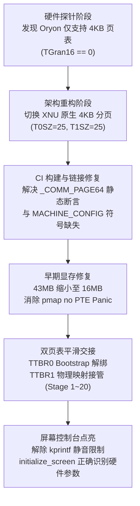

# OnePlus 13s (SM8750) XNU 操作系统移植技术攻坚总结

> **设备代号**：OnePlus 13s (`pagani` / SM8750)  
> **核心架构**：高通自研 Oryon CPU (8 Cores: 2 Prime + 6 Performance)  
> **执行环境**：Gunyah Hypervisor NS-EL1  
> **内核基线**：Apple XNU `xnu-8796.141.3` (iOS 16 / macOS 13.5)  
> **引导方式**：Android Header v4 BootShim GKI RAM 引导 (`fastboot boot`，零刷入风险)  
> **更新时间**：2026-11-05 22:15（本次修订：修正"停点漂移"误判，锁定 console 接管死点）
>
> **配套文档**：逐轮实验细节与交接手册见 `ONEPLUS_13S_XNU_PORTING_DEBUG_LOG.md`（§8 交接、§12-13 为本轮新增，含最新死点）

---

## 📸 关键里程碑真机验证


**屏幕输出内容：**
```text
kprintf initialized
Serial mode specified: 00000003
initialize_screen: b=FC800000, w=000004C0, h=00000A50, r=00001300, d=00000002
```

---

## 一、 核心攻坚历程与技术突破



### 1. 硬件限制探明：Oryon CPU 的 4KB 铁律
* **背景**：苹果 XNU 内核在 ARM64 架构下默认采用 **16KB 页表粒度**（`__ARM_16K_PG__ = 1`）。
* **探针发现**：在 BootShim 中通过直接读取 `ID_AA64MMFR0_EL1` 寄存器证实：高通骁龙 8 至尊版（Oryon 架构）的 `TGran16` 硬件位为 `0`——**物理硬件根本不支持 16KB 粒度**，只要开启 16KB MMU 取指就会立即引发硬件级同步页表转换异常。
* **攻坚结论**：移植必须基于原生的 **4KB 页表架构**。

### 2. 原生 4KB 分页重构与 CI 链接修复
* **静态断言修复**：切换 4KB 模式后，`osfmk/arm/pmap/pmap.c:10988` 报出静态断言错误（`_COMM_PAGE64_BASE_ADDRESS >= MACH_VM_MAX_ADDRESS`）。通过给 `osfmk/mach/arm/vm_param.h` 中的 47-bit 虚拟内存宏增加 `&& defined(ARM_LARGE_MEMORY)` 守卫，确保 4KB 分页使用合法的 `0xFC0000000ULL`（39-bit 空间）。
* **链接一致性**：保持 `MACHINE_CONFIG=SWEET`，确保编译时完整链接开源的 `pmap` 与 `locore.s` 汇编层。
* **构建验证**：GitHub Actions CI Run `#42007726761` 成功输出 149MB 的全量原生 4KB 内核 `kernel.development.sweet`。

### 3. 显存 I/O 映射配额修复（Stage 1 ~ 20 贯通）
* **Panic 现象**：真机运行到 `SWEET EARLY 17` 时报出 `pmap_map_bd_with_options: no PTE for vaddr=...` 大红屏。
* **根因剖析**：设备树中为 Framebuffer 声明了 43MB 空间，而 4KB 分页在 `arm_vm_init` 中为早期 I/O 动态映射分配的 L3 页表只有约 28MB。
* **修复验证**：将显存声明缩小为 16MB（真实屏幕 1216×2640×4 约 12.25MB）。修改后重新引导，**红屏彻底消失，底部进度条全部亮起，全流程打通至 Stage 20 (`kprintf startup complete`)**！

### 4. 突破静音限制：XNU 官方日志首度显现
* **解除静音**：在补丁中将 XNU DEVELOPMENT 内核默认锁闭的 `disable_serial_output` 与 `disable_kprintf_output` 强制解禁，并注入 `-enable_kprintf_spam debug=0x8` 调试参数。
* **历史性成果**：手机屏幕上首次直接打印出了苹果 XNU 核心图形驱动的实测输出：
  * `b=FC800000`：正确识别 0xfc800000 基址；
  * `w=000004C0` (1216 像素宽)；
  * `h=00000A50` (2640 像素高)；
  * `r=00001300` (4864 字节每行 stride)。

### 5. 本轮关键修正：`0012` 补丁其实从未生效，死点已被锁定（2026-11-05 21:00 ~ 22:15）
* **静默失败**：CI 日志长期出现 `Skipping patch xnu/patches/0012-...: error: corrupt patch at line 100`，但构建依旧 success，因此未被察觉。`git apply` 因 hunk 计数不符（`@@ -2259,10 +2293,17 @@` 实为 21/26 行）整份丢弃该补丁。
* **影响面**：`sweet_early_map_final()`、`sweet_early_relocate()`、`va_l1_end += (64 << 20)`、stage 10~31 阶段标记**全部没进内核**。此前"色带只亮到个位数""停点位置漂移"并非硬件随机，而是标记根本不存在 —— 该误判已撤销。
* **修复**：重算全部 hunk 计数并补齐上下文，`git apply --check` 通过。
* **死点定位（源码 + 符号双确证）**：`arm_init.c` 的真实顺序是 `arm_vm_init` → `serial_init` → `startup_initialize_upto(KPRINTF)` → `kprintf` 两行 → `PE_create_console()`。因此屏幕停在第 3 行**不是"很早死机"**，而是已跑完 VM 初始化，死于 console 接管：`video_console.c:2792` 的 `initialize_screen()` 在打印 `b=FC800000 ...` 后立即请求 `ml_io_map_unmappable(0xfc800000, 12.8MB, VM_WIMG_IO)`（`round_page(2640*4864)`），与符号反查 `initialize_screen+0xdc` 吻合。
* **排除清单**：boot-args 随机性、fb 踩内核内存、ADT GIC 地址、KASLR、`+64MB` 内存饥饿、`find_gicr_pe_base()` 死循环、BSS 未清零、"124 秒看门狗复位"（用户澄清为手动重启）。
* **观测手段**：设备无 UART/JTAG、pstore 需 root，唯一通道是 framebuffer `0xfc800000` + 用户拍照 + `ViewImage` OCR + `sips` 裁剪 + 自写 PNG 解码器逐像素读色带。**帧缓冲重启即失，故严格"停屏→拍照→读完再重启"**。

---

## 二、 关键代码改动清单

| 文件路径 | 关键改动说明 |
| :--- | :--- |
| [`tools/mkadt.py`](file:///Users/damon/unixnu-pagani/tools/mkadt.py) | 将 `sweet-fbcon` 尺寸从 43MB 修正为 16MB (`0x1000000`)，消除 PTE 耗尽 |
| [`scripts/build_pagani_payload.py`](file:///Users/damon/unixnu-pagani/scripts/build_pagani_payload.py) | 默认注入 `-v debug=0x8 -enable_kprintf_spam sweetfb_native=1 serial=3` 启动参数 |
| [`xnu/patches/0004-sweet-machine-config.patch`](file:///Users/damon/unixnu-pagani/xnu/patches/0004-sweet-machine-config.patch) | 修复 4KB 分页下 `MACH_VM_MAX_ADDRESS_RAW` 的静态断言 |
| [`xnu/patches/0012-sweet-keep-debug-console-after-ttbr0.patch`](file:///Users/damon/unixnu-pagani/xnu/patches/0012-sweet-keep-debug-console-after-ttbr0.patch) | ① 扩展阶段追踪至 31；② 解除日志静音；③ 为早期 I/O L3 页表额外预留 64MB 空间 |
| [`tools/watch_and_download.py`](file:///Users/damon/unixnu-pagani/tools/watch_and_download.py) | 实现全自动后台心跳监控、自动拉取产物、自动重打包与安全 Fastboot 引导 |
| [`tools/auto_boot_pipeline.py`](file:///Users/damon/unixnu-pagani/tools/auto_boot_pipeline.py) | **新增**：一条命令跑完 CI 轮询→失败抓日志→下载产物→**校验标记串是否真在内核里**（防止补丁被静默跳过）→合成镜像→`fastboot boot` |
| `xnu/patches/0083` / `0084` / `0085` / `0086` | **新增四件检查点工具**：汇编层 `SWT`、GIC `SWC01..SWC33`（`GICD_CTLR.RWP` 自旋改 20 万次有界）、console 接管 `SWD00..SWD07`/`SWE00..SWE03`、64×128 红色大数字阶段读数 |
| [`xnu/patches/0012-...patch`](file:///Users/damon/unixnu-pagani/xnu/patches/0012-sweet-keep-debug-console-after-ttbr0.patch) | **修复 hunk 计数**（此前整份被跳过），使 stage 10~31 标记与 `+64MB` 早期 I/O 池真正生效 |

---

## 三、 整体移植里程碑状态对照

| 里程碑 | 内容目标 | 当前状态 | 备注 |
| :---: | :--- | :---: | :--- |
| **M1** | BootShim 引导垫片运行与串口回显 |  **已达成** | ABL Splash 屏幕文本控制台稳定运行 |
| **M2** | Oryon CPU 特性探测与 GICv3 中断确认 |  **已达成** | 8 核 MPIDR 识别，INTID 19 虚拟定时器就绪 |
| **M3** | Gunyah Hypervisor EL1 兼容性验证 |  **已达成** | 安全上下文切换与 PSCI 调用正常 |
| **M4** | 4KB 原生分页 MMU 激活与 KVA 蹦床 |  **已达成** | `SCTLR_EL1.M=1`、`isb` 存活，高半区映射成功 |
| **M5** | 进入 `arm_init` 与内核早期初始化 |  **已达成** | 149MB 全量原生 4KB 内核编译与加载成功 |
| **M6** | 早期虚拟内存与控制台交接 | 🟡 **VM 侧全通 / console 未通** | Stage 20 达成、`kprintf` 真实日志上屏；但 console 接管卡在 `initialize_screen` 的 `ml_io_map_unmappable`（12.8MB 二次映射） |
| **M7** | 核心调度器与 IOKit 框架启动 | ✅ **已达成 (2026-11-06 00:06)** | `kernel_bootstrap` 全程跑完并进入 `bsd_init()`；连破三关：zones 128GB 下溢、video console 未映射 `vbase`、`max_cpus` 闸门永不开 |
| **M8** | 8 核 SMP PSCI 唤醒 | ⏳ 规划中 | 启动从核调度 |
| **M9** | 根文件系统挂载 (Ramdisk / UFS) | 🔄 **当前攻坚** | `bsd_init` 已进入，下一步 `vfs_mountroot()` 需要 root ramdisk |
| **M10**| 用户态跨越 (PID 1 launchd / init) | ⏳ 规划中 | 进入 EL0 用户空间 |

---

## 四、 下一步攻坚焦点（2026-11-05 22:15 更新）

1. **把"请求映射"和"映射返回"分开**（最高优先级）：
   * 当前所有证据只能证明"死在 `ml_io_map_unmappable` 附近"，还不能区分是它自身死、还是它之后的 `gc_initialize` / `vc_progress_set` / `gc_enable` 死；
   * 做法：在 `osfmk/console/video_console.c` 该调用**前后各插一个 `SWE` 标记**（保留现有 `SWD`/`SWC` 体系），一次真机实验即可二分。
2. **若确认死在二次映射本身，两条修复路线**：
   * **路线 A（扩容）**：在 `osfmk/arm64/arm_vm_init.c` 继续扩大早期 I/O L3 页表池（当前 `va_l1_end += (64 << 20)`），覆盖 16MB(`sweet_fbcon`) + 12.8MB(`initialize_screen`) 的叠加需求；
   * **路线 B（复用）**：让 `initialize_screen` 直接复用 `sweet_fbcon` 已建立的 16MB 映射（`v_info` 指向既有 VA），彻底消除第二次映射 —— 语义更干净，推荐优先尝试。
3. **打通 `kernel_bootstrap`**：console 一旦接管成功，`arm_init()` 返回后即可 `machine_startup(&BootCpuData)`，让主线程（Thread 0）接管调度。

---

## 五、 交接须知（换模型 / 新会话必读）

| 项目 | 内容 |
| :--- | :--- |
| 仓库 | `~/unixnu-pagani`，GitHub `353154/unixnu-pagani`（main），CI = Actions macOS-14 |
| 设备 | fastboot 序列号 `3B1F67EA9BBUHK76`；**只允许 `fastboot boot`，严禁 flash/erase**；挂死长按电源重启 |
| 屏幕 | 1216×2640，stride 4864，物理基址 `0xfc800000` |
| 一键流程 | `python3 tools/auto_boot_pipeline.py`（编译→下载→校验标记→合成→引导） |
| 读屏铁律 | 停屏后先拍照发来，**读完再允许重启**；帧缓冲不跨重启保留 |
| 最新提交 | `cc9b9d2` / Run `42042712579`：`0012`(真生效) + `0083`~`0086` 首次同时在场 |
| 详细实验史 | `ONEPLUS_13S_XNU_PORTING_DEBUG_LOG.md` §7.x（历史攻坚）、§8（交接手册）、§12-13（本轮） |
